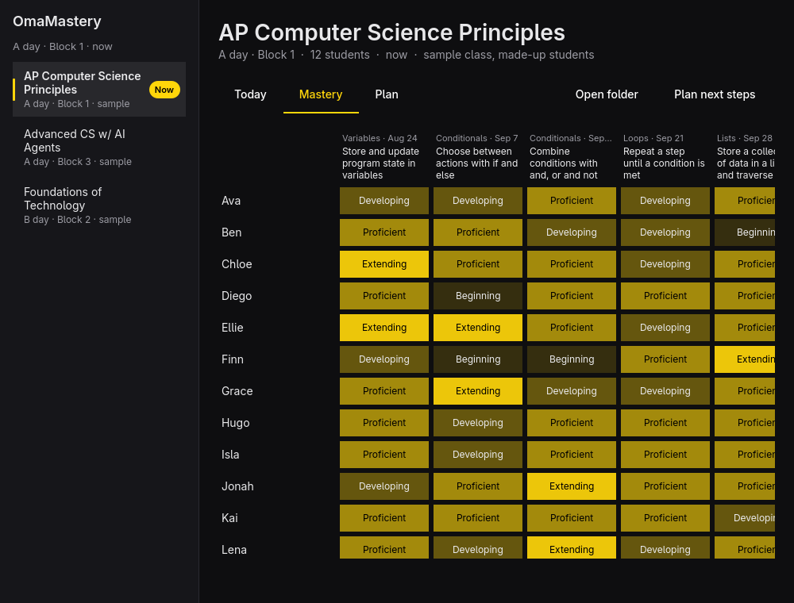

# OmaMastery

A mastery gradebook and planning hub for teachers on Omarchy, built to be
shaped with an AI agent. It opens to the class happening now, shows where the
class is on this week's objectives, and keeps a planning log you and your
agent write together.



## Plain files, so your agent can help

Everything lives in `~/Classes` as files you can read, and so can any AI agent:

| File | What it holds |
|---|---|
| `schedule.toml` | A/B days, the Friday rotation, days off, bell times |
| `<class>/class.toml` | Name, A/B day, block, OmaClass room |
| `<class>/roster.toml` | A real class's students: private, stays on this computer |
| `<class>/ideas.toml` | The course's core ideas and the shared joints they connect to |
| `<class>/plan.toml` | Learning objectives, each tied to a core idea and a week |
| `<class>/mastery.csv` | Append-only log of levels: Not yet → Extending |
| `<class>/notes.md` | The planning hub: next steps, newest first |
| `AGENTS.md` | How the files work and the rules an agent follows |

The app reloads the moment a file changes, so when your agent edits the plan
you see it right away. "Plan next steps", "Draft objectives" and "Space across
the semester" open your Omarchy agent (`omarchy agent prompt`) in the class's
folder with the task already written.

Levels are words, not scores, and none of them is a failure. Real student
names stay on your computer: the sample classes are made up, and `AGENTS.md`
tells agents to work only with sample classes until your school's AI policy
allows more.

## Bring in your classes (one time)

Open the link `omamastery://setup` (or press "Connect to Canvas"; in a
terminal, `omamastery setup`). Then:

1. Make a Canvas access token and paste it in.
2. Optionally sign in to Blackbaud for A/B days, blocks, rooms and bell times.
3. Tick your classes.

Each class gets its folder. Its assignments become a first `plan.toml`, one
objective per assignment in the week it's due. Work in an assignment group
named "Non-Mastery Assignments" is left out. A course with none falls back to
its Canvas Outcomes, then its modules. The syllabus and modules are saved for
planning. Drop in your long-range plan and press "Draft objectives", and
your agent ties each objective to a core idea. OmaClass picks up the classes and rooms
by itself. Run setup again each term: it refreshes rosters and keeps your
plans, mastery and any names you changed.

Real names stay on your computer. They go only in each class's `roster.toml`
and `mastery.csv` (owner-only). Setup never prints them and refuses to write
inside a git repo. `AGENTS.md` tells agents to work from a real class's plan
files and never open those two files or `notes.md`. Tokens are kept in your
keyring; `omamastery setup --forget` removes them. A school-wide Canvas
address and Blackbaud app go in `/etc/omamastery/connect.toml` (see
`docs/connect.toml.example`). A link like
`omamastery://setup?canvas=yourschool.instructure.com` fills in the address.

## Commands

| Command | Does |
|---|---|
| `omamastery` | Opens the app on the class happening now |
| `omamastery open <class>` | Opens a specific class |
| `omamastery now [--json]` | The class happening now, or next today |
| `omamastery classes [--json]` | Every class, for scripts and OmaClass |
| `omamastery init [--sample]` | Sets up `~/Classes`, optionally with sample classes |
| `omamastery setup` | Brings in your classes from Canvas (and Blackbaud); `--dry-run`, `--blackbaud`, `--forget` |
| `omamastery draft` | Opens your agent to draft objectives for your real classes |

## Keyboard

| Key | Does |
|---|---|
| `1` `2` `3` | Today, Mastery, Plan |
| `J` / `K` | Next or previous class |
| `N` | The class happening now |
| `Space` | Plan next steps with your agent |
| `O` | Open the class folder |
| Click / right-click | Raise or lower a level |
| `?` | Help |
| `Q` | Quit |

## Build

```sh
bin/build      # build/omamastery
bin/test       # unit tests, offscreen, and setup against a fake school
bin/install    # package and install, so it appears in the launcher
```

Needs Qt 6 (base, declarative, wayland) and `tomlplusplus`.
